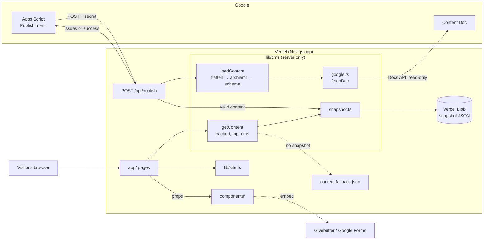

# RiC Website — Architecture Overview

A summary of how the Rooted in Cambodia (RiC) website is built: what runs where, the main components, how they connect, and the design choices behind them. Details live in `docs/spec.md` (architecture and behaviour), `docs/content-model.md` (Doc fields) and `docs/decisions.md` (decisions D1–D12, referenced below). Progress is tracked in `docs/progress.md`.

## 1. Platform and technology stack

The site is a **public website that runs in any web browser** (desktop and mobile). There is no app to install and no visitor login. Program directors edit the text in **Google Docs**, which they already use.

| Layer | Choice | Why it fits |
| --- | --- | --- |
| Language | TypeScript | One language for UI and server code; types catch content-shape mistakes before they reach the page |
| Framework | Next.js 16 (App Router), React 19 | Pages are pre-rendered and cached, so they load fast; server code (Publish API) lives in the same project, so no separate backend |
| Hosting | Vercel | Built for Next.js; every push gets its own Preview URL for review; secrets stay in Vercel env vars |
| Content source | Google Docs API (`@googleapis/docs`, service account, read-only) | Editors keep using Google Docs (D6) |
| Content format | ArchieML text + Markdown formatting, validated with zod | Plain-text format editors can type; a strict schema catches typos before publishing |
| Content store | One JSON snapshot in Vercel Blob | The only stored data is the last published content; no database needed |
| Styling | Tailwind CSS v4, tokens from Figma | Already set up; design values in one file (D11) |
| Donations, applications | Givebutter widget, Google Forms (embedded) | Payments and form data are handled by services RiC already uses |
| Tests | Vitest | Unit and route tests for the content pipeline |

**Team fit:** one TypeScript codebase, no servers or databases to run, and a Preview deployment for every change make it practical for a small student team, and maintainable by RiC after handoff.

## 2. Major components

| Component | Where | Responsibility |
| --- | --- | --- |
| **Content Doc** | Google Docs | Where editors write the site text, in ArchieML (`{home_page} … {}`) |
| **Publish menu** | `apps-script/Code.gs` (runs in Google) | Adds "Website → Publish to website" to the Doc; calls the Publish API and shows the result as a popup |
| **Publish API** | `app/api/publish/route.ts` | Checks the publish secret, runs the content pipeline, saves the result, clears the page cache |
| **Content pipeline** | `lib/cms/` | `google.ts` fetches the Doc → `flatten.ts` turns Docs JSON into text → archieml parses it → `schema.ts` validates it and writes editor-friendly errors (`droppedText.ts` catches text lost to a missing `:end`) → `loadContent.ts` runs the whole chain |
| **Snapshot store** | `lib/cms/snapshot.ts` + Vercel Blob | Keeps the last content that passed validation, separately per environment (D3) |
| **Content reader** | `lib/cms/getContent.ts` | What pages call: the cached snapshot, or `content.fallback.json` if there is none |
| **Data model** | `SiteContent` type in `lib/cms/schema.ts` | The contract between the pipeline and the UI; generated from the zod schema |
| **Pages** | `app/**/page.tsx` | Thin connectors: get data (`getContent()`, `lib/site.ts`) and pass it to a component |
| **UI components** | `components/` | Presentational only: render props; no data fetching. `RichText` renders the Doc's Markdown safely |
| **Site settings** | `lib/site.ts` | Text and links kept in code: navigation, contact details, embed URLs (D9, D10) |
| **External embeds** | Givebutter, Google Forms | Donations and applications, shown on `/donate` and `/apply` with a plain-link fallback |

In MVC terms: the **Model** is the content (Doc → validated `SiteContent` snapshot), the **View** is `components/`, and the **Controller** role is split between the Publish API (changes the model) and the page files (pick the data for each view).

## 3. Component relationships

Two flows share the snapshot and never meet otherwise:

**Publish flow (editor, rare):** Editor clicks Publish → Apps Script sends `POST /api/publish` with the secret → the pipeline fetches and validates the Doc → if valid, the snapshot is saved and the `cms` cache tag is cleared, and the popup says "Published"; if not, nothing changes and the popup lists what to fix.

**Visit flow (visitor, constant):** Browser requests a page → the page calls `getContent()` → cached content, or on a cache miss the snapshot, or if that is missing `content.fallback.json` → the page passes it to a component → HTML. **Visitors never cause a Google API call.**

**Boundaries:**
- `components/` may only import *types* from `lib/cms/schema.ts`. A lint rule enforces this, so UI work never needs Google or Vercel credentials.
- `lib/cms/` modules that touch secrets import `server-only`, so they can never be bundled for the browser.

**Extension points:**
- **New Doc section** (e.g. FAQ): add it to `docs/content-model.md`, then to the zod schema, then pass `content.faq_list` from the page to its component. The pipeline needs no change.
- **New page:** add a route in `app/`, a component in `components/` and a menu item in `lib/site.ts`.
- **Visual design:** change Tailwind tokens and components only; no data code changes.

## 4. Key design decisions

| Question | Choice | Why (alternative rejected) |
| --- | --- | --- |
| How do editors update text? | Google Doc + a **Publish** button | Editors already use Docs. Real-time sync was rejected: half-finished edits and typos would go live |
| When is the Doc read? | **Only on Publish**; visitors read a stored snapshot | Fetching on every visit would hit Google quotas, break the site during Google outages, and could show unpublished typos |
| Backend? | **No separate backend or database.** One API route plus a JSON file in Vercel Blob | The only stored data is the published content |
| Doc format | **ArchieML + Markdown**, strict zod schema, friendly messages, "did you mean" hints | Plain text editors can type. Strict keys catch typos (`hero_titel`). Missing `:end` is caught separately because the parser drops text silently (D1) |
| Rich text safety | Only `p`, `br`, `strong`, `em`, `a`; links only http/https/mailto; no raw HTML | Nothing typed into the Doc can inject scripts (D7) |
| Google access | **Service account**, read-only, Docs-only client | API keys cannot read private Docs; the Docs-only package is far smaller than `googleapis` (D6) |
| Site structure | **One page per menu item**; Program Info shown on `/apply` | Matches the design's navigation (D9) |
| Contact | **Static details**, no form | A form would need an email service (D10) |
| Styling | **Tailwind v4** with Figma tokens | Already installed; one place for design values (D11) |
| Images | Files in the repo (`public/`), `next/image` | Editing images from the Doc is out of scope (D12) |
| Environments | `main` → Preview, `production` branch → Production; snapshots separated per environment | Testing never touches the live site or its data (D3, D8) |
| Unbuilt parts | **Documented stubs** in place | The planned structure is visible in the repo while the build stays green (D12) |

## 5. Repository map and status

| Path | Status |
| --- | --- |
| `lib/cms/flatten.ts`, `schema.ts`, `droppedText.ts`, `loadContent.ts`, `google.ts` | Built and tested |
| `lib/cms/getContent.ts` | Built (fallback only); snapshot + cache in step 4 |
| `lib/cms/snapshot.ts` | Stub (step 4) |
| `app/api/publish/route.ts` | Stub, answers 501 (step 5) |
| `apps-script/Code.gs` | Stub (step 6) |
| `app/page.tsx`, `components/HomePage.tsx`, `components/RichText.tsx` | Built (unstyled) |
| Other routes in `app/`, their components, `SiteHeader`, `SiteFooter`, `EmbedFrame` | Stubs (D9, D12) |
| `lib/site.ts` | Navigation filled in; contact and embed URLs still TODO |

Stubs contain a doc comment that describes the planned behaviour and `TODO(...)` notes. Search for `TODO(` to list the remaining work.
