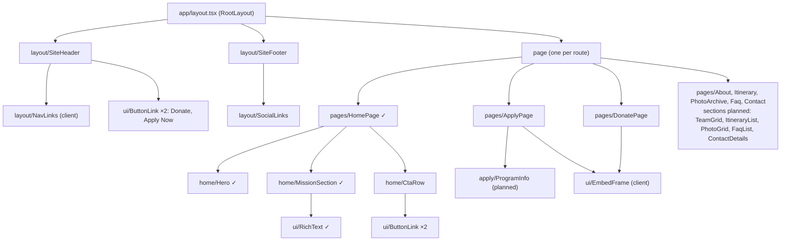
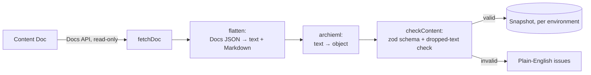
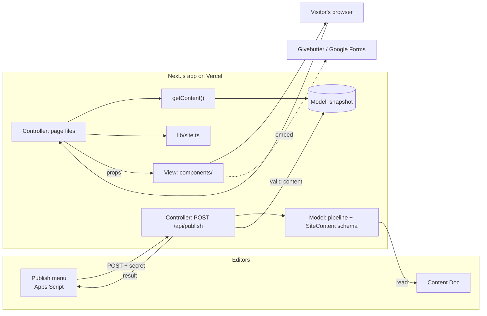

# RiC Website — Architecture Overview

How the Rooted in Cambodia (RiC) website is built, organised as Model / View / Controller. Details live in `docs/spec.md` (behaviour), `docs/content-model.md` (Doc fields) and `docs/decisions.md` (decisions D1–D14, referenced below). Progress: `docs/progress.md`.

## 1. Two users, two interfaces

The system has two graphical interfaces for two groups of people.

| Interface | Users | What they do | Built with |
| --- | --- | --- | --- |
| **Public website** | Prospective applicants (Cambodian Americans, 21–26), donors | Learn about the program, apply, donate | Next.js pages in a web browser, desktop and mobile |
| **Editing interface** | Program directors (Sophy, Navin) | Change the site's text without technical help | A Google Doc, a "Website → Publish to website" menu, and result popups |

Most of the engineering so far went into the editing interface. It has to be safe for non-technical editors: a typo in the Doc must never break the public site, and every problem must be explained in plain English (section 3d).

## 2. Platform and technology stack

| Layer | Choice | Why it fits |
| --- | --- | --- |
| Environment | Web browser (desktop and mobile); Google Docs for editing | Nothing to install for visitors or editors |
| Language | TypeScript | One language for UI and server code; types catch content-shape mistakes |
| Framework | Next.js 16 (App Router), React 19 | Server-rendered, cached pages; server code (Publish API) in the same project, so no separate backend |
| Rendering | Server Components, pre-rendered; client code only for embeds and the mobile menu (D13) | Fast on phones; main content works without JavaScript |
| Hosting | Vercel | Built for Next.js; every change gets a Preview URL; secrets in env vars |
| Content | Google Docs API (read-only service account, `@googleapis/docs`); ArchieML + Markdown; zod schema | Editors keep using Docs (D6); strict schema catches typos |
| Content store | One JSON snapshot in Vercel Blob | Only the published content is stored; no database |
| Styling | Tailwind CSS v4, tokens from Figma (D11) | Already set up; design values in one file |
| Donations, applications | Givebutter widget, Google Forms (embedded) | Services RiC already uses |
| Tests | Vitest | Pipeline, schema, renderer and route tests |

**Team fit:** one TypeScript codebase, no servers or databases to run, and a Preview deployment for every change. A small student team can build it, and RiC can maintain it after handoff.

## 3. Architecture in Model–View–Controller terms

| Role | In this system | Where |
| --- | --- | --- |
| **Model** | `SiteContent`: the zod schema and its TypeScript type; the published snapshot; the fallback copy | `lib/cms/schema.ts`, Vercel Blob, `content.fallback.json` |
| **View** | Presentational React components, built from the Figma design; they only receive props | `components/` |
| **Controller** | Page files that pick the data for each view; the Publish API that updates the model | `app/**/page.tsx`, `app/api/publish/route.ts` |
| **External services** | Content source and embedded services | Google Docs (+ Apps Script menu), Givebutter, Google Forms |

### 3a. View

**Pages (D9).** One route per menu item in the design:

| Route | Shows | Data from |
| --- | --- | --- |
| `/` | Hero title, mission | Doc `home_page` |
| `/about` | Story, team | Doc `about_us`; photos in code |
| `/itinerary` | Day-by-day plan | Doc `itinerary` |
| `/photo-archive` | Photo gallery | Images in code |
| `/faq` | Questions and answers | Doc `faq_list` |
| `/contact` | Email, social links | `lib/site.ts` (D10) |
| `/donate` | Givebutter widget | Embed |
| `/apply` | **Program Info** (eligibility, important dates), then the Google Form | Doc `program_info` + embed |

**Component tree (D14).** Folders by role. Built parts are marked ✓; the rest exist as documented stubs; "planned" parts get files when their Figma frames exist.

**UI states.** The site is mostly static, so state is small and local (D13):

| Component | States |
| --- | --- |
| `EmbedFrame` | loading → loaded, or failed → shows a plain link to the Givebutter / Google Forms page |
| `NavLinks` | current page highlighted; mobile menu open / closed |
| Page content | published snapshot or fallback copy (looks the same to visitors) |

### 3b. Model

`SiteContent` is the contract between the content pipeline and the UI. Components receive slices of it as props (`HomePage` gets `SiteContent['home_page']`). Today it holds `home_page`; each new section is added to `docs/content-model.md` and the schema together.

Content enters the model only through Publish:

Pages read the model through `getContent()`: cached content, else the snapshot, else `content.fallback.json`.

### 3c. Controller

- **Page files** (`app/**/page.tsx`): call `getContent()` and/or read `lib/site.ts`, then pass props to one `pages/` component. No layout or styling logic.
- **Publish API** (`POST /api/publish`): the only code that changes the model. It checks the secret, runs the pipeline, saves a valid snapshot, and clears the page cache (`revalidateTag('cms', …)`). It answers 200 / 401 / 422 / 502 / 500.
- **Apps Script menu** (`apps-script/Code.gs`): the editing interface's controller. It sends the Publish request and turns the answer into a popup.

### 3d. Editing interface

1. The editor changes text in the Doc. Nothing on the site changes yet.
2. The editor clicks **Website → Publish to website**.
3. A popup shows the result:
   - **"Published! The website is now updated."**
   - **"Not published. Please fix these:"** followed by every problem at once
   - **"Could not read the Doc / try again"** for system errors

Design rules for the messages (`MESSAGES` in `lib/cms/schema.ts`):
- Each message names the section and the key to check, e.g. "Home page title is missing. Check that the line starts with hero_title:".
- Typos get a suggestion: "hero_titel: did you mean hero_title?".
- Text dropped by a missing `:end` is quoted back to the editor (D1).
- A failed Publish never changes the site.

## 4. Component relationships

- **Publish flow** (editors, occasional): Doc → Publish menu → Publish API → pipeline → snapshot → popup.
- **Visit flow** (visitors, constant): browser → page → `getContent()` → props → components → HTML. **Visitors never cause a Google API call**, so Google outages and quotas cannot take the site down.
- The two flows meet only at the snapshot.

**Boundaries:**
- `components/` may only `import type` from `lib/cms/schema.ts`. A lint rule enforces this, so UI work never needs credentials and can run on the fallback content.
- Modules holding secrets import `server-only`.

## 5. Extension points

- **New editable section** (e.g. FAQ):
  1. Add its fields to `docs/content-model.md` and the zod schema.
  2. Build its section components (e.g. `faq/FaqList`).
  3. Pass `content.faq_list` from the page file to the page component.
  
  The pipeline does not change.
- **New page:** a route in `app/`, a component in `components/pages/`, a menu item in `lib/site.ts`.
- **Apply the Figma design:** Tailwind tokens and components only; no data code changes.
- **Change the editor messages:** edit `MESSAGES` in `lib/cms/schema.ts` only.

## 6. Key design decisions

| Question | Choice | Why (alternative rejected) |
| --- | --- | --- |
| How do editors update text? | Google Doc + **Publish** button | Editors already use Docs. Real-time sync would publish half-finished edits and typos |
| When is the Doc read? | **Only on Publish**; visitors read a snapshot | Reading on every visit risks quotas, outages and unpublished typos |
| Backend? | **No separate backend or database** | The only stored data is the published content |
| Single-page app or separate pages? | **Separate server-rendered pages**; client code only for embeds and the mobile menu (D13) | Mostly reading; fast on phones; little state to break |
| How is the UI split? | **Folders by role; one component per Figma section** (D14) | Design frames map 1:1 to files; shared pieces in one place |
| UI library? | **Hand-rolled components with Tailwind** (D11) | No component library needed; Figma tokens map directly |
| Doc format and safety | **ArchieML + Markdown, strict schema, restricted renderer** (only `p`, `br`, `strong`, `em`, `a`; safe links) | Typos are caught and explained; nothing typed in the Doc can inject scripts (D1, D7) |
| Google access | **Read-only service account**, Docs-only client (D6) | API keys cannot read private Docs |
| Program Info | **On `/apply`**, above the form (D9) | No menu item in the design; applicants need it right before applying |
| Contact | **Static details**, no form (D10) | A form would need an email service |
| Environments | `main` → Preview, `production` branch → Production; snapshots per environment (D3, D8) | Testing never touches the live site |

## 7. Repository map and status

| Path | Status |
| --- | --- |
| `lib/cms/` `flatten`, `schema`, `droppedText`, `loadContent`, `google` | Built and tested |
| `lib/cms/getContent.ts` | Built (fallback only); snapshot and cache in step 4 |
| `lib/cms/snapshot.ts`, `app/api/publish/route.ts` (501), `apps-script/Code.gs` | Stubs (steps 4–6) |
| `components/pages/HomePage`, `home/Hero`, `home/MissionSection`, `ui/RichText` | Built (unstyled) |
| `components/layout/*`, `home/CtaRow`, `ui/ButtonLink`, `ui/EmbedFrame`, other `pages/*` | Stubs |
| `lib/site.ts` | Navigation filled in; contact and embed URLs TODO |

Stubs have a doc comment describing the planned behaviour and `TODO(...)` notes (D12). Search for `TODO(` to list the remaining work.
