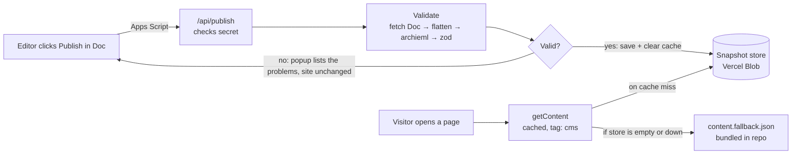

# RiC Website — Technical Spec

Nov 5, 2026 · Joomee Choi
Exported from the team Doc: https://claude.ai/artifact/SPkhaxEwotpWC3TppLWWiQ

## Overview

We are building one Next.js site for Rooted in Cambodia (RiC) whose text is edited in a single Google Doc and goes live only when an editor presses Publish and the content passes validation. Target: mid-December 2026.

**Problem.** RiC's current site is static and fragmented. Applying and donating happen off-site, and the program directors cannot update text without technical help.

**Users.**

| User | Need | In usability testing |
| --- | --- | --- |
| Prospective applicants (Cambodian Americans, 21–26) | Understand the program and apply | Yes (via Sandra) |
| Donors | Give a tax-deductible donation without friction | Yes |
| Program directors (Sophy Yem, Navin Moul) | Update site text from a Google Doc | No |

**In scope:** five text sections fed from the Doc (Home, About Us, Program Info, FAQ, Itinerary), a Publish button inside the Doc, validation with readable errors, Givebutter donation widget and Google Forms application embedded in the site.

**Out of scope:** user login (OAuth), editing images, fonts or layout from the Doc, managing embed code from the Doc, a draft/preview workflow (see Open questions).

## Changes from the original proposal

Eight statements in the proposal's "Notes for Developers" are replaced by decisions verified in the spike (Node script, Nov 2026). Where the two disagree, this spec wins.

| Proposal said | Decision | Why |
| --- | --- | --- |
| Doc changes sync to the site in real time | Site changes only when an editor clicks **Publish** in the Doc | Real time would push half-finished edits and typos live; Publish is the moment we validate |
| Sections written as `[+home_page] … []` | Sections written as `{home_page} … {}` | Verified: `[+name]` returns a list of `{type, value}` pairs, not an object with named fields |
| Press Enter to create new paragraphs | Multi-paragraph fields must end with `:end` | Verified: without `:end`, every paragraph after the first is silently dropped |
| "Restricted API key" | Service account key (JWT client), scope `documents.readonly` | API keys cannot read private Docs; a service account can, read-only |
| Fetch at build time (SSG) or in the browser on page load | Fetch on the server at Publish time; pages read a validated snapshot in Vercel Blob | Browser fetch would expose credentials; SSG needs a rebuild for every edit |
| Convert Docs styles straight to `<b>`, `<i>`, `<a>` HTML | Convert to Markdown (`**`, `_`, `[text](url)`), render with a restricted renderer | ArchieML needs plain text; Markdown survives parsing; no raw HTML from the Doc reaches the page |
| Content fetched from Google on visits | Visitors never trigger a Google API call | Avoids Google quota limits and keeps the site up if Google or the Doc fails |
| Only About, FAQ, Important Dates and Eligibility are dynamic | Home and Itinerary are also edited from the Doc (five sections) | Decided Nov 5, 2026; matches the proposal's own list of editable pages |

## Tech stack

One Next.js app on Vercel; the only extra service is a small JSON snapshot store.

| Layer | Choice | Notes |
| --- | --- | --- |
| Framework | Next.js 16 (App Router), TypeScript | CMS routes use the Node.js runtime (`googleapis` does not run on Edge) |
| Hosting | Vercel | Env vars hold all secrets |
| Content source | Google Docs API v1 via `googleapis` | Service account, JWT client, `documents.readonly` |
| Doc → text | `flatten()` (from the spike) | Pure function, moves to `lib/cms/flatten.ts` |
| Text → JSON | `archieml` 0.5 | |
| Validation | `zod` | Strict schema: unknown keys are errors |
| Snapshot store | Vercel Blob, one JSON file | Holds the last content that passed validation |
| Caching | Next.js cache with tag `cms`, cleared on Publish | `revalidateTag` — confirm the Next.js 16 signature at implementation |
| Rich text rendering | `react-markdown`, only `p`, `strong`, `em`, `a` allowed | Links limited to `http`, `https`, `mailto` |
| Layout | CSS Flexbox, containers grow with text | Per proposal |
| Publish button | Google Apps Script custom menu in the Doc | Calls `/api/publish` |
| Donations | Givebutter widget, hardcoded | Not managed from the Doc |
| Applications | Google Forms `<iframe>`, hardcoded | Not managed from the Doc |
| Tests | `node:test` (or the app's test runner) | Ports the spike's 32 tests |

## Architecture and data flow

Google is called only when an editor publishes; visitors read a stored snapshot that already passed validation.

Only a passing Publish writes the snapshot; visitors read the snapshot, or the bundled fallback if it is missing.

**Publish flow** (editor clicks Website → Publish to website):

1. Apps Script sends `POST /api/publish` with the publish secret.
2. The route fetches the Doc, runs `flatten()` → `archieml.load()` → zod.
3. Pass: write the JSON to the snapshot store, then clear the `cms` cache tag.
4. Fail: change nothing and return the list of problems; Apps Script shows them in a popup.

**Visitor flow:**

1. A page calls `getContent()`, cached under tag `cms`.
2. On a cache miss it reads the snapshot JSON from the store.
3. If the store is empty or unreachable, it uses `content.fallback.json` bundled in the repo.

**Why a snapshot instead of re-fetching the Doc:** if pages fetched the Doc on a cache miss, an editor's unpublished typo made after a Publish could reach visitors and break the page. Storing the validated result means visitors only ever see content that passed validation, and the Doc is fetched once per Publish.

Code layout:

| File | Role |
| --- | --- |
| `lib/cms/google.ts` | `fetchDoc()`: JWT client, Docs API call (`server-only`) |
| `lib/cms/flatten.ts` | Docs JSON → Markdown-flavoured text (pure) |
| `lib/cms/schema.ts` | zod schema + friendly error messages |
| `lib/cms/loadContent.ts` | fetch → flatten → archieml → validate; returns success or issues, never throws on bad content |
| `lib/cms/snapshot.ts` | read/write the snapshot JSON |
| `lib/cms/getContent.ts` | cached read used by pages |
| `app/api/publish/route.ts` | Publish endpoint |
| `content.fallback.json` | Last known good content, committed to git |

## Content model

Five sections, each an ArchieML object; lists use `[name] … []` with a repeating first key.

The field list and the Doc template live in [`docs/content-model.md`](content-model.md), which takes precedence over this spec for fields.

Rules the schema enforces: every required field is non-empty after trimming; unknown keys are errors (catches typos like `hero_titel`); every list item has all its keys.

## Editor rules (for Sophy and Navin)

Eight rules, written so they can be pasted at the top of the content Doc. Each one prevents a failure we reproduced in the spike.

1. Change only the words after `key:`. Never rename or retype a key (`hero_title`), and keep it lowercase.
2. If a field has more than one paragraph, put `:end` on its own line after the last paragraph.
3. Inside a long field, if a line starts with a word and a colon (`Note: ...`), type a backslash first: `\Note: ...`. Otherwise the text after it is cut off.
4. Bold, italic and links are kept. Fonts, colours, sizes, images and tables are ignored.
5. Do not use the Docs bullet-list button inside the content area. For repeating items, copy an existing block (e.g. a `question:` / `answer:` pair).
6. Keys are case-sensitive. If Docs auto-capitalizes `hero_title` to `Hero_title`, turn off Tools → Preferences → Automatically capitalize words.
7. Editing the Doc does not change the website. Click **Website → Publish to website** when ready.
8. If Publish shows a list of problems, fix them and publish again. The website keeps showing the last good version until then.

## Publish API

`POST /api/publish` validates the Doc and either publishes it or returns what to fix; it never leaves the site half-updated.

Request: header `x-publish-secret: <PUBLISH_SECRET>`, no body. Compared with `timingSafeEqual`. `GET` is not accepted (link previews and crawlers must not trigger it).

Steps:

1. Check the secret → 401 if wrong.
2. `loadContent()`: fetch Doc → `flatten()` → `archieml.load()` → zod.
3. Validation fails → 422 with issues; nothing is written.
4. Write snapshot JSON to the store → 500 if the write fails; cache untouched.
5. Clear the `cms` cache tag with immediate expiry, so the editor sees the new content on the next page load.

Responses:

| Status | Body | Apps Script popup |
| --- | --- | --- |
| 200 | `{ ok: true, publishedAt }` | "Published! The website is now updated." |
| 401 | `{ ok: false, error: "unauthorized" }` | "Something went wrong (401). Please contact the dev team." |
| 422 | `{ ok: false, issues: ["Home page title is missing...", ...] }` | "Not published. Please fix these:" + issues |
| 502 | `{ ok: false, error: "fetch_failed" }` | "Could not read the Doc. Please contact the dev team." |
| 500 | `{ ok: false, error: "store_failed" }` | "Publishing failed, please try again in a minute." |

Two Publish clicks close together: each validates independently and the last successful write wins. Acceptable for two editors.

## Error handling

No failure on the content side can take the site down: every failure either leaves the last published version in place or falls back to the bundled copy.

| Failure | Detected by | Who sees what | Site state |
| --- | --- | --- | --- |
| Typo in a key, missing field, missing `:end` that drops text | zod in `/api/publish` (422) | Editor: popup listing each problem in plain English | Unchanged |
| Wrong or missing publish secret | Route (401) | Editor: "contact the dev team" | Unchanged |
| Doc unshared, API disabled, wrong `DOC_ID` | Docs API 403/404 → route (502) | Editor: "could not read the Doc"; cause in Vercel logs | Unchanged |
| Snapshot write fails | Route (500) | Editor: "try again in a minute" | Unchanged |
| Snapshot read fails during render | `getContent()` catches | Visitor: last cached page or `content.fallback.json`; error in logs | Up, possibly older |
| No snapshot yet (first deploy) | `getContent()` | Visitor: `content.fallback.json` | Up |
| Google outage | n/a | Nobody: visitors never call Google | Up |
| Givebutter or Google Forms embed fails to load | Component load timeout | Visitor: plain link to the Givebutter / Forms page | Up |

Error messages for editors: each zod issue is mapped to a sentence that names the section and the key to check, e.g. `home_page.hero_title: Required` → "Home page title is missing. Check that the line starts with hero_title:". Unknown keys suggest the closest valid key ("hero_titel — did you mean hero_title?").

Logging: `console.error` to Vercel logs with status and message only; never log key material, the secret, or full Doc content.

## Security and secrets

Three secrets with very different blast radii; the service account key and the Blob token are the ones that must never leak.

| Secret | Protects | Lives in | If leaked |
| --- | --- | --- | --- |
| Service account key (`GOOGLE_CLIENT_EMAIL`, `GOOGLE_PRIVATE_KEY`) | Read access to every Doc shared with the account | Vercel env; `.env.local` locally; never in git | Anyone can read the content Doc. Delete the key in Google Cloud → IAM → Service accounts, issue a new one |
| `BLOB_READ_WRITE_TOKEN` | Writing the snapshot the site displays | Vercel env only | Anyone can replace site text, skipping validation. Rotate in Vercel |
| `PUBLISH_SECRET` | Triggering a publish | Vercel env + Apps Script properties | Low: can only re-publish what is in the Doc, or burn Docs API quota. Rotate both places |

`PUBLISH_SECRET` is visible to anyone with edit access to the Doc (they can open the Apps Script project). This is accepted because it cannot change content.

Rules:

- CMS modules import `server-only`; no secret uses a `NEXT_PUBLIC_` name.
- `GOOGLE_PRIVATE_KEY` is stored with `\n` escapes and restored with `.replace(/\\n/g, '\n')`.
- Rendered links allow only `http`, `https`, `mailto` (blocks `javascript:` links typed into the Doc).
- Doc sharing: service account as Viewer; edit access only for Sophy, Navin and the dev team.
- `.gitignore` covers `.env*` and key JSON files; check `git status` before the first commit.

## Testing plan

The CMS pipeline is tested without touching the real Doc; the real Doc is checked by hand once per formatting behaviour.

| Level | What | How |
| --- | --- | --- |
| Unit | `flatten()`: plain, bold, italic, link, bold+link, spaces and newlines outside markers, `\u000b`, split runs, skipped elements | Port the spike's tests (30 pass, 2 todo for overlapping styles) |
| Unit | ArchieML behaviour we rely on: `:end`, `{}` vs `[+]`, list splitting, `Note:` lines | Port the spike's learning tests; they break first if `archieml` changes |
| Unit | Schema: valid fixture passes; missing field, typo key, empty list, missing `answer` each fail with the expected friendly message | Fixture JSON files |
| Route | No secret → 401; invalid fixture → 422 and no snapshot write; valid → 200 and snapshot written | Mock `fetchDoc()` and the store |
| Manual (Doc) | Auto bullets, auto-capitalization, smart quotes and dashes, URL auto-linking, paste from web, suggestion mode, Enter vs Shift+Enter | Edit a copy of the Doc, publish to a preview deploy |
| End-to-end | Publish from the Doc menu on a Vercel preview URL; a typo shows the popup and the site is unchanged | Apps Script cannot reach `localhost`: use a preview deploy or a tunnel |
| Usability | Applicants and donors complete apply/donate tasks | Per proposal, recruited through Sandra |

## Known limitations and risks

Accepted for the December release; each has a stated workaround.

| Limitation or risk | Impact | Workaround / mitigation |
| --- | --- | --- |
| Overlapping styles (bold word partly italic; part of a link bold) render with extra markers or a split link | Cosmetic glitch in rare cases | Editor rule: apply one style per phrase. Fix later with tree-based rendering |
| Literal `*`, `_`, `[` in text are read as formatting; `_italic_` inside a word does not render | Odd formatting | Rare in this content; escape in `flatten()` if it appears |
| A line starting `Word:` inside a long field becomes a new key | Text cut off | Unknown-key validation catches it at Publish; editor rule 3 |
| Images and tables in the Doc are ignored | Editor expects them to appear | Stated in editor rules; images are managed in code |
| No draft or preview: Publish goes straight live | A valid but wrong edit goes live | Fast to fix and re-publish; preview route is an open question |
| Service account key does not expire | Long-lived credential | Read-only scope, one shared Doc; rotate at handoff |
| Google Cloud project, Vercel and Doc are owned by student accounts | Site breaks or becomes unmaintainable after the course | Transfer ownership to RiC/SEAFN before handoff (open question) |

## Open questions

Decided Nov 5, 2026: the snapshot store is Vercel Blob, and all five sections are edited from the Doc. Five questions remain; the Itinerary shape blocks its schema.

- [ ] **Itinerary shape.** Is `day` / `title` / `details` right, or is it a plain list? If a list, do we support the Docs bullet button by having `flatten()` turn bullets into `* ` lines?
- [ ] **Team bios.** Photos are not editable from the Doc. Hardcode photos keyed by name, or drop photos?
- [ ] **Error message wording.** Draft the friendly messages with Jeff, and check them with Sophy and Navin.
- [ ] **Preview before publish.** Is a `/preview` page (shows the Doc's current content and errors, not public) worth adding before December?
- [ ] **Ownership after the course.** Who owns the Google Cloud project, Vercel project, Blob store, domain and content Doc after handoff, and when is the transfer done?
